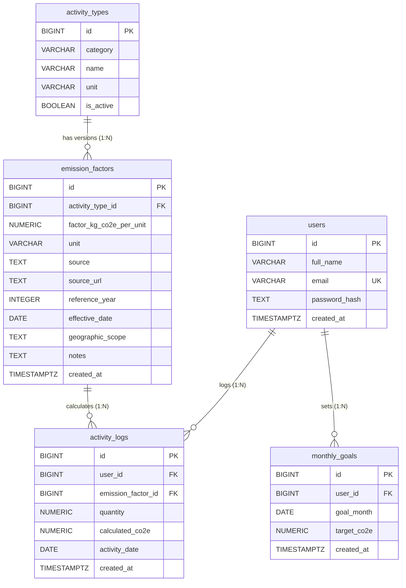

# EcoTrack — PostgreSQL DBMS Architecture & Documentation

## 1. Entity-Relationship (ER) Diagram



### Relationships Summary
- `users (1) -> (N) activity_logs` (`ON DELETE CASCADE`)
- `users (1) -> (N) monthly_goals` (`ON DELETE CASCADE`)
- `activity_types (1) -> (N) emission_factors` (`ON DELETE RESTRICT`)
- `emission_factors (1) -> (N) activity_logs` (`ON DELETE RESTRICT`)

---

## 2. Core Academic Tables (5 Tables)

### Table 1: `users`
Stores registered EcoTrack accounts with normalized email addresses and salted bcrypt password hashes.
- **Primary Key**: `id BIGINT GENERATED BY DEFAULT AS IDENTITY`
- **Unique Constraints**: `uq_users_email UNIQUE (email)`
- **Check Constraints**: `chk_users_email_normalized CHECK (email = LOWER(TRIM(email)))`, `chk_users_full_name_nonempty CHECK (LENGTH(TRIM(full_name)) >= 2)`

### Table 2: `activity_types`
Catalog of supported sustainability activity categories (`Transportation`, `Energy`, `Lifestyle`), activity names, and measurement units.
- **Primary Key**: `id BIGINT GENERATED BY DEFAULT AS IDENTITY`
- **Unique Constraints**: `uq_activity_types_category_name UNIQUE (category, name)`
- **Check Constraints**: `category IN ('Transportation', 'Energy', 'Lifestyle')`, non-empty `unit`
- **Indexes**: `idx_activity_types_category_active (category, is_active)`

### Table 3: `emission_factors`
Stores documented, versioned carbon emission factors (`kg CO2e` per unit) linked to an `activity_type_id`. Preserves historical factors by versioning on `(activity_type_id, effective_date, source)`.
Migration `003_emission_factor_metadata.sql` adds non-breaking provenance metadata columns (`unit`, `source_url`, `reference_year`, `geographic_scope`, `notes`).
- **Primary Key**: `id BIGINT GENERATED BY DEFAULT AS IDENTITY`
- **Foreign Key**: `activity_type_id REFERENCES activity_types(id) ON DELETE RESTRICT`
- **Unique Constraints**: `uq_emission_factors_version UNIQUE (activity_type_id, effective_date, source)`
- **Check Constraints**: `factor_kg_co2e_per_unit >= 0`, non-empty `source`
- **Indexes**: `idx_emission_factors_type_effective (activity_type_id, effective_date DESC)`

### Table 4: `activity_logs`
Records individual user carbon-emitting activities, storing both the raw `quantity` (`NUMERIC(12,3)`) and the server-calculated `calculated_co2e` (`NUMERIC(18,6)`) linked to the exact `emission_factor_id` applied.
- **Primary Key**: `id BIGINT GENERATED BY DEFAULT AS IDENTITY`
- **Foreign Keys**:
  - `user_id REFERENCES users(id) ON DELETE CASCADE`
  - `emission_factor_id REFERENCES emission_factors(id) ON DELETE RESTRICT`
- **Check Constraints**: `quantity > 0`, `calculated_co2e >= 0`
- **Indexes**: `idx_activity_logs_user_date (user_id, activity_date DESC)`, `idx_activity_logs_factor_id (emission_factor_id)`, `idx_activity_logs_user_co2e (user_id, calculated_co2e DESC)`

### Table 5: `monthly_goals`
Stores each user's monthly carbon emission budget (`target_co2e`) where `goal_month` is anchored to the first day of the month (e.g., `2026-11-01`).
- **Primary Key**: `id BIGINT GENERATED BY DEFAULT AS IDENTITY`
- **Foreign Key**: `user_id REFERENCES users(id) ON DELETE CASCADE`
- **Unique Constraints**: `uq_monthly_goals_user_month UNIQUE (user_id, goal_month)`
- **Check Constraints**: `EXTRACT(DAY FROM goal_month) = 1`, `target_co2e > 0`
- **Indexes**: `idx_monthly_goals_user_month (user_id, goal_month DESC)`

---

## 3. Infrastructure Tables (Separate from Core Academic Tables)

1. `schema_migrations` — Managed by `server/db/migrate.ts` (`version VARCHAR(150) PRIMARY KEY`, `applied_at TIMESTAMPTZ`). Tracks which `.sql` migration scripts have executed.
2. `session` — Managed by `connect-pg-simple` (`sid VARCHAR PRIMARY KEY`, `sess JSON`, `expire TIMESTAMP(6)`, indexed via `IDX_session_expire`). Persists Express HTTP-only sessions in PostgreSQL.

---

## 4. Normalization to Third Normal Form (3NF)

1. **First Normal Form (1NF)**: Every column holds atomic scalar values (no comma-separated lists or repeating groups). Each table has an explicit surrogate `id` primary key.
2. **Second Normal Form (2NF)**: Every table uses a single-column primary key (`id`), so no partial dependencies on a composite key can exist.
3. **Third Normal Form (3NF)**: Non-key attributes depend solely on the primary key (`the key, the whole key, and nothing but the key`):
   - `activity_logs` does not duplicate `category`, `name`, `unit`, or `source`; it references `emission_factor_id`, which references `activity_type_id`.
   - `emission_factors` stores versioned factor metadata separately from `activity_types`, preventing update anomalies when emission factors are revised for a new year.
   - `monthly_goals` separates monthly budget targets from `users` and `activity_logs`.

---

## 5. Database Connection, Migrations & Seeding Procedure

### Connection Process
1. Read `DATABASE_URL` from server environment variables (`server/config/env.ts`). Never expose `DATABASE_URL` to Vite or browser bundles.
2. Automatically enable TLS (`ssl: { rejectUnauthorized: true }`) for Neon PostgreSQL (`*.neon.tech` or `sslmode=require`).
3. Create a single shared `pg.Pool` (`server/db/connection.ts`) with parameterized queries (`$1, $2, ...`) to prevent SQL injection, and close it cleanly on `SIGINT`/`SIGTERM`.

### Running Migrations & Seeds
```bash
# Apply SQL migrations in server/db/migrations/ (001, 002, 003)
npm run db:migrate

# Idempotently seed activity_types (8 items) and documented emission_factors (6 verified factors)
npm run db:seed
```

---

## 6. Documented Emission Factors (Phase 3 Provenance & Assumptions)

All seeded factors come from published national inventories, international guidelines, or government conversion tables (`server/db/seeds/seedEmissionFactors.ts`).

| Category | Activity Type | Unit | Factor (`kg CO2e/unit`) | Reference Year | Effective Date | Source & Scope |
| :--- | :--- | :---: | :---: | :---: | :---: | :--- |
| Transportation | Car Travel | `km` | `0.14000000` | 2015 | `2015-01-01` | India GHG Program (Hatchback `<1400 cc` Gasoline, 8% uplift) — `https://indiaghgp.org/` |
| Transportation | Motorcycle Travel | `km` | `0.05160000` | 2015 | `2015-01-01` | India GHG Program (Two-wheelers Petrol baseline) — `https://indiaghgp.org/` |
| Transportation | Bus Travel | `km` | `0.01516000` | 2015 | `2015-01-01` | India GHG Program (Intracity Bus, passenger-km basis) — `https://indiaghgp.org/` |
| Transportation | Metro Travel | `km` | `0.02860000` | 2024 | `2024-06-01` | UK DESNZ / Defra 2024 Light rail & tram average (UK proxy; Indian city grids vary) — `https://www.gov.uk/government/collections/government-conversion-factors-for-company-reporting` |
| Energy | Electricity Consumption | `kWh` | `0.72700000` | 2024 | `2024-04-01` | Central Electricity Authority (CEA), Ministry of Power, Govt. of India — CO₂ Baseline Database v20.0 (FY 2023–24, `0.727 tCO2/MWh`) — `https://cea.nic.in/` |
| Energy | LPG Cooking Gas | `kg` | `2.98463000` | 2006 | `2006-04-01` | 2006 IPCC Guidelines Vol. 2 Ch. 2 (`63,100 kg CO2/TJ × 47.3 TJ/Gg`, Global Tier 1 default) — `https://www.ipcc-nggip.iges.or.jp/public/2006gl/vol2.html` |

### Why Lifestyle Meal Factors Are Intentionally Unconfigured
- Peer-reviewed dietary lifecycle studies (e.g., Poore & Nemecek 2018; Scarborough et al. 2023) report daily diet totals or per-kg ingredient footprints rather than a single universal per-meal constant.
- Rather than inventing an arbitrary number, EcoTrack leaves `Plant-Based Meal` and `Meat-Based Meal` unseeded in `emission_factors`. Selecting them in the UI displays `"Emission factor unavailable for this activity."`, and `POST /api/activities` responds with `422 Unprocessable Entity`.
- **Configuring Regional Meal Factors**: Administrators can insert peer-reviewed regional per-meal factors directly into `emission_factors`:
```sql
INSERT INTO emission_factors (
  activity_type_id,
  factor_kg_co2e_per_unit,
  unit,
  source,
  source_url,
  reference_year,
  effective_date,
  geographic_scope,
  notes
)
SELECT
  id,
  <verified_factor_kg_co2e_per_meal>,
  'meals',
  '<Published LCA Study Name>',
  '<https://...>',
  2024,
  '2024-01-01',
  '<Region>',
  '<Portion size and boundary assumptions>'
FROM activity_types
WHERE category = 'Lifestyle' AND name = 'Plant-Based Meal';
```

### Historical Factor Preservation on Edits
- When a user updates **only `quantity`** (`PUT /api/activities/:id`), EcoTrack locks the row with `SELECT ... FOR UPDATE`, keeps the existing `emission_factor_id`, and recalculates `calculated_co2e` using that exact historical factor so past entries are not silently altered by newer factor revisions.
- When a user changes **`activityTypeId` or `activityDate`**, the backend queries `emission_factors` for the newest factor with `effective_date <= activity_date` and stores the updated `emission_factor_id` and `calculated_co2e`.

---

## 7. Educational SQL Examples (Phase 3 Activity Tracking)

> Note: These examples demonstrate relational SQL concepts on EcoTrack's schema and are kept separate from production code.

### 1. `INSERT` — Log a calculated activity for a user
```sql
INSERT INTO activity_logs (
  user_id,
  emission_factor_id,
  quantity,
  calculated_co2e,
  activity_date
)
VALUES (1, 1, 25.500, 3.570000, '2026-11-16')
RETURNING id, calculated_co2e, created_at;
```
*Explanation:* Inserts a `25.500 km` Car Travel log referencing `emission_factor_id = 1` (`0.14000000 kg CO2e/km`), persisting the backend-calculated `3.570000 kg CO2e` in `activity_logs`.

### 2. `SELECT` — Retrieve applicable emission factor for an activity date
```sql
SELECT id, factor_kg_co2e_per_unit, source, effective_date
FROM emission_factors
WHERE activity_type_id = 1
  AND effective_date <= '2026-11-16'
ORDER BY effective_date DESC, id DESC
LIMIT 1;
```
*Explanation:* Picks the most recent versioned emission factor effective on or before `'2026-11-16'` without applying future factor revisions retroactively.

### 3. `UPDATE` — Update an owned activity's quantity and emissions
```sql
UPDATE activity_logs
SET quantity = 40.000,
    calculated_co2e = 5.600000
WHERE id = 10 AND user_id = 1;
```
*Explanation:* Updates both `quantity` and `calculated_co2e` while enforcing `user_id = 1` ownership in the `WHERE` clause.

### 4. `DELETE` — Remove a specific owned activity log
```sql
DELETE FROM activity_logs
WHERE id = 10 AND user_id = 1;
```
*Explanation:* Permanently deletes activity `10` only if it belongs to `user_id = 1`.

### 5. `INNER JOIN` — Combine activity logs with factors and activity types
```sql
SELECT
  al.id,
  al.activity_date,
  at.category,
  at.name AS activity_name,
  al.quantity,
  at.unit,
  ef.factor_kg_co2e_per_unit,
  ef.source,
  al.calculated_co2e
FROM activity_logs al
INNER JOIN emission_factors ef ON al.emission_factor_id = ef.id
INNER JOIN activity_types at ON ef.activity_type_id = at.id
WHERE al.user_id = 1
ORDER BY al.activity_date DESC, al.id DESC;
```
*Explanation:* Joins three normalized tables so each logged activity displays its category, name, unit, applied factor, and source alongside the stored `calculated_co2e`.

### 6. `GROUP BY` & `SUM` — Total emissions per category for a user
```sql
SELECT
  at.category,
  COUNT(*)::INTEGER AS activity_count,
  SUM(al.calculated_co2e) AS total_co2e_kg
FROM activity_logs al
INNER JOIN emission_factors ef ON al.emission_factor_id = ef.id
INNER JOIN activity_types at ON ef.activity_type_id = at.id
WHERE al.user_id = 1
GROUP BY at.category
ORDER BY total_co2e_kg DESC;
```
*Explanation:* Aggregates activity counts and total `kg CO2e` per category (`Transportation`, `Energy`, `Lifestyle`).

### 7. `ORDER BY` & `LIMIT/OFFSET` — Paginate highest-emission activities
```sql
SELECT al.id, al.activity_date, at.name, al.calculated_co2e
FROM activity_logs al
INNER JOIN emission_factors ef ON al.emission_factor_id = ef.id
INNER JOIN activity_types at ON ef.activity_type_id = at.id
WHERE al.user_id = 1
ORDER BY al.calculated_co2e DESC, al.id DESC
LIMIT 10 OFFSET 0;
```
*Explanation:* Sorts a user's activity logs from highest emissions downward using `idx_activity_logs_user_co2e` and returns page 1 (10 rows).

### 8. `COUNT` — Count activities and distinct activity types in a date range
```sql
SELECT
  COUNT(*) AS total_activities,
  COUNT(DISTINCT ef.activity_type_id) AS distinct_activity_types
FROM activity_logs al
INNER JOIN emission_factors ef ON al.emission_factor_id = ef.id
WHERE al.user_id = 1
  AND al.activity_date >= '2026-11-01'
  AND al.activity_date <= '2026-11-30';
```
*Explanation:* Computes both total entries and distinct activity types recorded within a date window.

### 9. `AVG` — Calculate average emissions per logged activity
```sql
SELECT AVG(calculated_co2e) AS avg_co2e_per_entry
FROM activity_logs
WHERE user_id = 1;
```
*Explanation:* Computes the arithmetic mean `kg CO2e` across all activity log entries for user `1`.

---

## 8. Phase 4 — How PostgreSQL Powers the Dashboard & Carbon Analytics

All statistics and Recharts visualizations on `/` (Dashboard) and `/analytics` (Carbon Emission Analytics) are computed directly in PostgreSQL via `/api/analytics/*` using parameterized queries scoped strictly to `req.authUser.id`.

### 1. Monthly Emissions & `SUM()` / `COUNT()`
```sql
SELECT
  COALESCE(SUM(calculated_co2e), 0)::text AS total_emissions,
  COUNT(*)::text AS activity_count
FROM activity_logs
WHERE user_id = $1
  AND activity_date >= '2026-11-01'::date
  AND activity_date < '2026-12-01'::date;
```
*Explanation:* `WHERE user_id = $1` enforces user isolation. Half-open calendar boundaries (`>= month_start` and `< next_month_start`) ensure November 30 is included and December 1 is excluded without converting `DATE` columns to text. `SUM(calculated_co2e)` totals emissions across all matching rows, while `COUNT(*)` counts logged activities. `COALESCE(..., 0)` ensures empty months return `0` rather than `NULL`.

### 2. Calendar Daily Average vs. Per-Activity Average
- **Daily Average Emissions**: `Monthly Total Emissions / Elapsed Calendar Days` (using `Asia/Kolkata` as the reporting timezone: elapsed days through today for the current month, or full calendar days for completed months—including `29` days in leap-year February).
- This calendar-day metric is distinct from `AVG(calculated_co2e)` (average per logged entry).

### 3. `DATE_TRUNC()` & `GROUP BY` — Monthly Emission Trend (6 or 12 Months)
```sql
SELECT
  TO_CHAR(DATE_TRUNC('month', activity_date), 'YYYY-MM') AS month_key,
  COALESCE(SUM(calculated_co2e), 0)::text AS total_emissions,
  COUNT(*)::text AS activity_count
FROM activity_logs
WHERE user_id = $1
  AND activity_date >= '2026-06-01'::date
  AND activity_date < '2026-12-01'::date
GROUP BY DATE_TRUNC('month', activity_date)
ORDER BY DATE_TRUNC('month', activity_date) ASC;
```
*Explanation:* `DATE_TRUNC('month', activity_date)` normalizes every `activity_date` to the first day of its month so `GROUP BY` produces one aggregate row per active month. `server/services/analyticsService.ts` maps those rows onto the full 6-month or 12-month calendar sequence so zero-activity months appear as `0.00 kg CO2e` instead of disappearing from the chart.

### 4. `INNER JOIN` & `GROUP BY` — Category Breakdown & Percentages
```sql
SELECT
  at.category,
  COALESCE(SUM(al.calculated_co2e), 0)::text AS total_emissions,
  COUNT(*)::text AS activity_count
FROM activity_logs al
INNER JOIN emission_factors ef ON ef.id = al.emission_factor_id
INNER JOIN activity_types at ON at.id = ef.activity_type_id
WHERE al.user_id = $1
  AND al.activity_date >= $2::date
  AND al.activity_date < $3::date
GROUP BY at.category
ORDER BY SUM(al.calculated_co2e) DESC, at.category ASC;
```
*Explanation:* Because `activity_logs` is normalized to 3NF, it stores `emission_factor_id` rather than duplicating category names. `INNER JOIN` connects `activity_logs -> emission_factors -> activity_types` so PostgreSQL can group and sum emissions by `Transportation`, `Energy`, and `Lifestyle`. Category shares are computed as `(Category Emissions / Total Emissions) * 100` (returning `0` safely when total emissions equal `0`).

### 5. Daily Calendar Aggregation
```sql
SELECT
  activity_date::text AS day_date,
  COALESCE(SUM(calculated_co2e), 0)::text AS total_emissions,
  COUNT(*)::text AS activity_count
FROM activity_logs
WHERE user_id = $1
  AND activity_date >= $2::date
  AND activity_date < $3::date
GROUP BY activity_date
ORDER BY activity_date ASC;
```
*Explanation:* Groups rows by `activity_date` in PostgreSQL and fills every calendar day (`1..28/29/30/31`) on the backend so zero-activity days render accurately in the Daily Emission Trend chart without sending unbounded raw records to React.

### 6. Monthly Comparisons & Zero-Safe Math
- Percentage change compares the selected month against the previous calendar month: `((Current - Previous) / Previous) * 100`.
- When `Previous = 0`, division by zero is avoided (`percentageChange: null`, rendered as `"N/A"` alongside the absolute `kg CO2e` difference).
- For the active current month, EcoTrack labels full-prior-month comparisons as month-to-date vs full prior month and also computes an apples-to-apples same-number-of-elapsed-days comparison.

### 7. Indexing & Numeric Handling
- Migration `001_create_core_tables.sql` defines `idx_activity_logs_user_date ON activity_logs (user_id, activity_date DESC)`.
- Migration `004_analytics_indexes.sql` adds `idx_activity_logs_user_recent ON activity_logs (user_id, activity_date DESC, created_at DESC, id DESC)` to accelerate both date-range analytics and the Dashboard's latest-5 recent activities query.
- `node-postgres (pg)` returns PostgreSQL `NUMERIC` columns as strings to avoid precision loss. The backend converts and validates finite numbers (`parseNumericValue`, `roundToDecimals`) before returning JSON to React/Recharts.

---

## 9. Phase 5 — Sustainability Goals, Recommendations, Advanced Filters, CSV Export & Profile Persistence

### 1. Monthly Sustainability Goals (`monthly_goals`) & Uniqueness Enforcement
- Stored in `monthly_goals` (`id`, `user_id`, `goal_month`, `target_co2e`, `created_at`).
- **Database Constraints**:
  - `uq_monthly_goals_user_month UNIQUE (user_id, goal_month)` prevents duplicate targets for the same user and calendar month (`23505` unique violation mapped to `409 Conflict` in `server/services/goalService.ts`).
  - `CHECK (EXTRACT(DAY FROM goal_month) = 1)` anchors every goal to the first day of its month (`YYYY-MM-01`).
  - `CHECK (target_co2e > 0)` ensures positive carbon budgets.

### 2. Comparing Monthly Targets Against Actual Emissions (`LEFT JOIN` + `SUM`)
```sql
SELECT
  mg.id,
  mg.user_id,
  mg.goal_month::text AS goal_month,
  mg.target_co2e::text AS target_co2e,
  mg.created_at,
  COALESCE(SUM(al.calculated_co2e), 0)::text AS actual_emissions,
  COUNT(al.id)::text AS activity_count
FROM monthly_goals mg
LEFT JOIN activity_logs al
  ON al.user_id = mg.user_id
 AND al.activity_date >= mg.goal_month
 AND al.activity_date < (mg.goal_month + INTERVAL '1 month')::date
WHERE mg.user_id = $1
GROUP BY mg.id, mg.user_id, mg.goal_month, mg.target_co2e, mg.created_at
ORDER BY mg.goal_month DESC, mg.id DESC;
```
*Explanation:* `LEFT JOIN` ensures months with a configured goal but zero recorded activities still appear with `actual_emissions = 0`, while half-open calendar bounds avoid per-row date string casting. Progress classification (`WITHIN_TARGET` `<80%`, `APPROACHING_TARGET` `80–99.9%`, `AT_TARGET` `=100%`, `TARGET_EXCEEDED` `>100%`) runs deterministically in `server/utils/goalValidation.ts`.

### 3. Rule-Based Personalized Recommendations (`GET /api/recommendations`)
- EcoTrack uses deterministic rule logic (`server/utils/recommendationEngine.ts`) over real PostgreSQL aggregates from `getAnalyticsOverview()` — zero AI/ML APIs and zero invented values:
  - **Highest Category Rule**: Inspects `highestCategory` (`Transportation`, `Energy`, `Lifestyle`) and cites exact PostgreSQL kg CO₂e totals and percentage shares.
  - **Goal Comparison Rule**: Compares `actualEmissionsKg` against `targetCo2eKg` (`TARGET_EXCEEDED` vs within target vs no goal set).
  - **Empty State Onboarding Rule**: Returns onboarding guidance when zero activities are recorded for the period.

### 4. Advanced Parameterized Activity Filtering (`minEmissions` / `maxEmissions`)
```sql
WHERE al.user_id = $1
  AND at.category = $2
  AND al.activity_date >= $3::date
  AND al.activity_date <= $4::date
  AND al.calculated_co2e >= $5::numeric
  AND al.calculated_co2e <= $6::numeric
```
*Explanation:* A single shared helper `buildActivityFilterWhereClause()` powers `GET /api/activities`, `GET /api/activities/summary`, and `GET /api/reports/export`, guaranteeing table rows, aggregate KPI totals, and exported CSV rows always reflect the exact same parameterized `WHERE` predicates (`idx_activity_logs_user_co2e` assists emission-range queries).

### 5. Relational CSV Report Export (`GET /api/reports/export`)
```sql
SELECT
  al.activity_date::text AS activity_date,
  at.category,
  at.name AS activity_type_name,
  al.quantity::text AS quantity,
  at.unit,
  ef.factor_kg_co2e_per_unit::text AS factor_kg_co2e_per_unit,
  al.calculated_co2e::text AS calculated_co2e,
  ef.source
FROM activity_logs al
INNER JOIN emission_factors ef ON ef.id = al.emission_factor_id
INNER JOIN activity_types at ON at.id = ef.activity_type_id
WHERE al.user_id = $1
ORDER BY al.activity_date DESC, al.id DESC
LIMIT 5001;
```
*Explanation:* Joins `activity_logs -> emission_factors -> activity_types`, bounds output to `5,000` rows (`413` if exceeded), emits UTF-8 BOM + RFC-4180 escaping, and neutralizes spreadsheet formula injection (`=`, `+`, `-`, `@`, `\t`, `\r`) via `sanitizeAndEscapeCsvCell()`.

### 6. Authenticated Profile Settings (`GET /api/profile` & `PUT /api/profile`)
```sql
UPDATE users
SET full_name = $1
WHERE id = $2
RETURNING id, full_name, email, created_at;
```
*Explanation:* Updates only `full_name` for `req.authUser.id` while leaving normalized `email` read-only and never returning `password_hash`.


