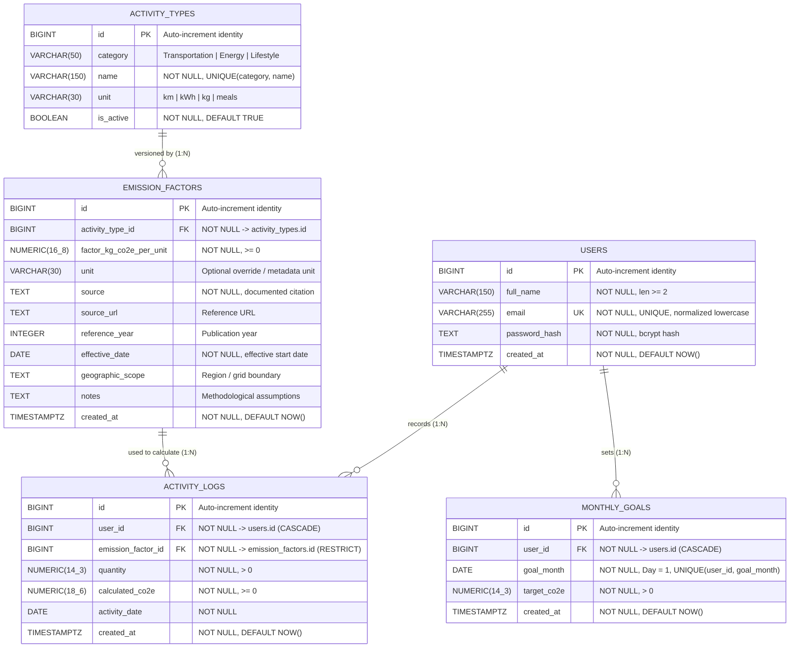

# EcoTrack — Entity-Relationship (ER) Diagram & Cardinality Guide

This document describes the relational entity model implemented in `server/db/migrations/001_create_core_tables.sql` and `003_emission_factor_metadata.sql`.

---

## 1. Mermaid ER Diagram



---

## 2. ASCII Entity-Relationship Overview

```text
+-------------------+          1:N          +------------------------+
|       users       |---------------------->|     monthly_goals      |
|-------------------|  (ON DELETE CASCADE)  |------------------------|
| PK id             |                       | PK id                  |
|    full_name      |                       | FK user_id -> users.id |
| UK email          |                       |    goal_month (day=1)  |
|    password_hash  |                       |    target_co2e (> 0)   |
+-------------------+                       +------------------------+
          |
          | 1:N (ON DELETE CASCADE)
          v
+------------------------+       N:1       +---------------------------+       N:1       +-------------------+
|     activity_logs      |---------------->|     emission_factors      |---------------->|  activity_types   |
|------------------------|  (RESTRICT)     |---------------------------|  (RESTRICT)     |-------------------|
| PK id                  |                 | PK id                     |                 | PK id             |
| FK user_id             |                 | FK activity_type_id       |                 |    category       |
| FK emission_factor_id  |                 |    factor_kg_co2e_per_unit|                 |    name           |
|    quantity (> 0)      |                 |    source                 |                 |    unit           |
|    calculated_co2e     |                 |    effective_date         |                 |    is_active      |
|    activity_date       |                 +---------------------------+                 +-------------------+
+------------------------+
```

---

## 3. Relationship & Referential Integrity Rules

1. **`users` to `activity_logs` (One-to-Many)**:
   - One user can log zero, one, or many carbon activities (`user_id REFERENCES users(id) ON DELETE CASCADE`).
   - Deleting a user automatically removes their personal activity records while leaving shared `emission_factors` and `activity_types` untouched.
2. **`users` to `monthly_goals` (One-to-Many)**:
   - One user can configure at most one target per calendar month (`UNIQUE (user_id, goal_month)`), across many months (`ON DELETE CASCADE`).
3. **`activity_types` to `emission_factors` (One-to-Many)**:
   - Each activity type (e.g., `Car Travel`, `Electricity Consumption`) can have multiple historical factor versions over time differentiated by `effective_date` and `source` (`ON DELETE RESTRICT`).
4. **`emission_factors` to `activity_logs` (One-to-Many)**:
   - Every logged activity references the exact `emission_factor_id` used to calculate its `calculated_co2e` (`ON DELETE RESTRICT`).
   - Deleting an activity log **never** deletes its emission factor, and `ON DELETE RESTRICT` prevents deleting a factor that is already cited by historical user activity logs.

---

## 4. Infrastructure Tables (Non-Academic)

In addition to the five core domain tables above, two operational infrastructure tables exist:
- `schema_migrations`: Tracks applied `.sql` migration files (`version` PK, `applied_at`).
- `session`: Stores encrypted/serialized Express session JSON for `connect-pg-simple` (`sid` PK, `sess`, `expire`).
